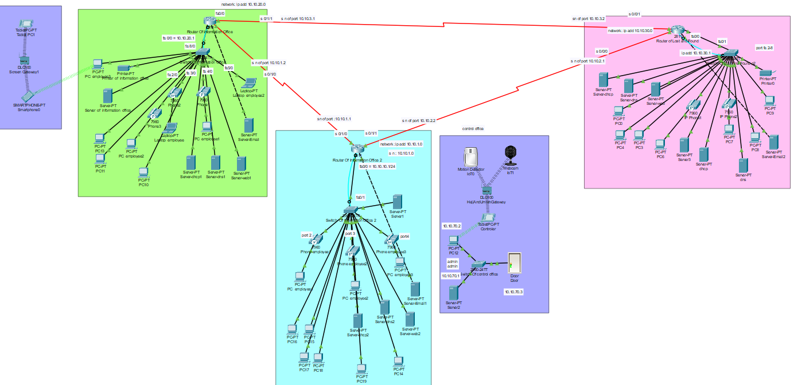
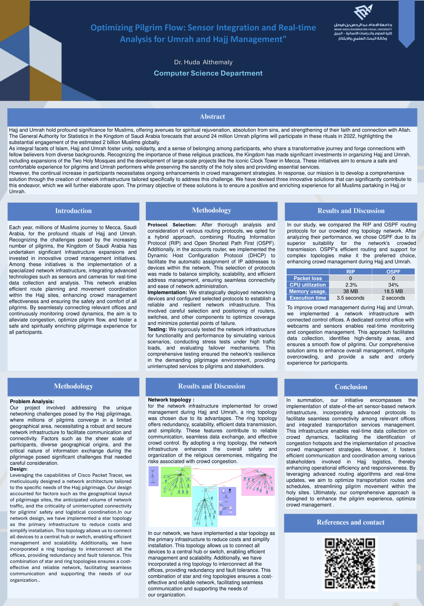

# 🕋 Optimizing Pilgrim Flow

**Sensor integration and real-time analysis for Umrah and Hajj management.** A network infrastructure designed and simulated in **Cisco Packet Tracer**.

Millions of pilgrims gather in Makkah every year, and managing the crowds safely depends on fast communication between the offices that serve them. This project designs a network that connects the **Lost & Found office** and the **information offices** at Masjid al-Haram with a **control office** that uses sensors and cameras for real-time crowd monitoring and congestion management.

> Team project for **IT Infrastructure Management**, Computer Science Department, Imam Abdulrahman Bin Faisal University (IAU).

<p align="center">
  
</p>

---

## 🎯 Goal

Design and configure a reliable network for Hajj and Umrah that:
- connects the offices serving pilgrims so they can share information instantly,
- integrates **sensors and cameras** for real-time crowd data,
- uses dynamic routing (**RIP** and **OSPF**) and compares their performance,
- automates addressing (DHCP) and secures the devices.

## 🌐 Network design

| | |
|---|---|
| **Topology** | Hybrid **star + ring**. Each office uses a star (central switch) for low cost and easy scaling, and the office routers are linked in a **ring** for redundancy, so traffic keeps flowing if one link fails. |
| **Offices** | Lost & Found office · two Information offices · Control office |
| **Control office** | Webcam, motion detectors, smart door and a home gateway for real-time monitoring |
| **Devices** | 3 routers · 3 switches · 6 servers (DHCP, DNS, Web, Email) · 10+ PCs · 5+ IP phones · laptops, printers, tablets, smartphone |
| **Links** | Serial connections between routers, straight-through Ethernet inside offices, wireless for mobile devices |
| **Addressing** | `10.10.x.0/24` subnet per office (for example Lost & Found `10.10.30.0/24`, Information offices `10.10.20.0/24` and `10.10.10.0/24`) |

## ⚙️ Configuration

- **Routing:** static routes + **RIP** on all offices, then **OSPF** for comparison
- **DHCP:** hosts get IP addresses automatically from the router or DHCP server
- **Services:** DNS, Web and Email servers
- **Device security:** console, enable and VTY passwords on routers and switches, plus `logging synchronous` and `exec-timeout`
- **Full addressing table, CLI configuration and screenshots** are in the reports in [`docs/`](docs)

## 📊 Results: RIP vs OSPF

| Metric | RIP | OSPF |
|---|---|---|
| Packet loss | 0 | 0 |
| CPU utilization | 2.3% | 34% |
| Memory usage | 38 MB | 18.5 MB |
| Execution time | 3.5 s | **2 s** |

**OSPF** was chosen for the final network. It converges faster, uses less memory, and handles complex, crowded topologies better than RIP, at the cost of higher CPU use.

## 📁 Repository contents

```
.
├── network/
│   ├── pilgrim-flow-network-final.pkt   # ⭐ Final network (open in Cisco Packet Tracer)
│   └── milestone2-rip-ospf.pkt          # Milestone 2: routing protocols (RIP + OSPF)
├── docs/
│   ├── poster.pdf                       # Project poster: abstract, methodology, results
│   ├── milestone2-routing-protocols.pdf # Milestone 2 report: topology, addressing, RIP & OSPF
│   ├── milestone3-final-report.pdf      # Final report: full configuration, DHCP, security, comparison
│   ├── references.pdf
│   └── images/
└── README.md
```

## ▶️ How to open

1. Install [Cisco Packet Tracer](https://www.netacad.com/courses/packet-tracer) (free with a Cisco NetAcad account).
2. Open `network/pilgrim-flow-network-final.pkt`.
3. Use **Simulation** mode to watch packets travel between the offices, or ping between devices to test connectivity.

## 🖼️ Poster

<p align="center">
  
</p>

## 📚 References

- Felemban, E. A., et al. (2020). *Digital revolution for Hajj crowd management: a technology survey.* IEEE Access, 8, 208583–208609.
- Rahman, M. A., & Kabir, A. I. (2023). *A network design and simulation of a Smart Railway Station using Cisco Packet Tracer.*
- Santana, J. R., et al. (2020). *A privacy-aware crowd management system for smart cities and smart buildings.* IEEE Access, 8, 135394–135405.
- Wang, A., Guo, Y., Hao, F., Lakshman, T. V., & Chen, S. (2014). *Scotch: Elastically scaling up SDN control-plane using vSwitch based overlay.* CoNEXT '14, 403–414.

---

<details>
<summary>🇸🇦 ملخص بالعربي</summary>

مشروع **تحسين تدفق الحجاج**: تصميم شبكة بأداة Cisco Packet Tracer تربط مكاتب خدمة الحجاج والمعتمرين في المسجد الحرام (مكتب المفقودات ومكاتب الاستعلامات)، مع مكتب تحكم فيه حساسات وكاميرات لمراقبة الحشود في الوقت الفعلي.

استخدمنا تصميم هجين (Star + Ring) عشان نجمع بين قلة التكلفة واستمرار الاتصال لو انقطع رابط. وقارنّا بين بروتوكولي التوجيه RIP وOSPF، واخترنا OSPF لأنه أسرع وأقل استهلاك للذاكرة.

مشروع مادة إدارة البنية التحتية لتقنية المعلومات، جامعة الإمام عبدالرحمن بن فيصل.
</details>
